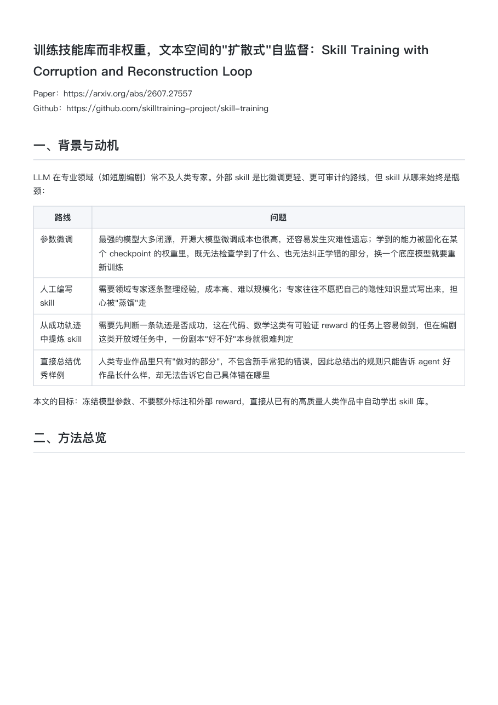
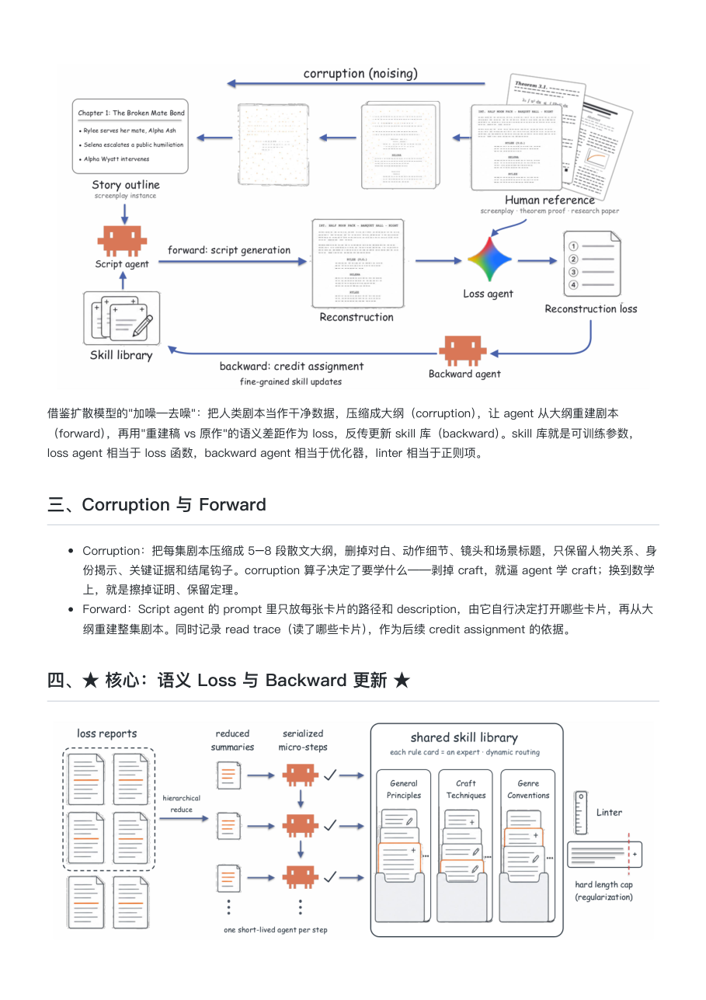
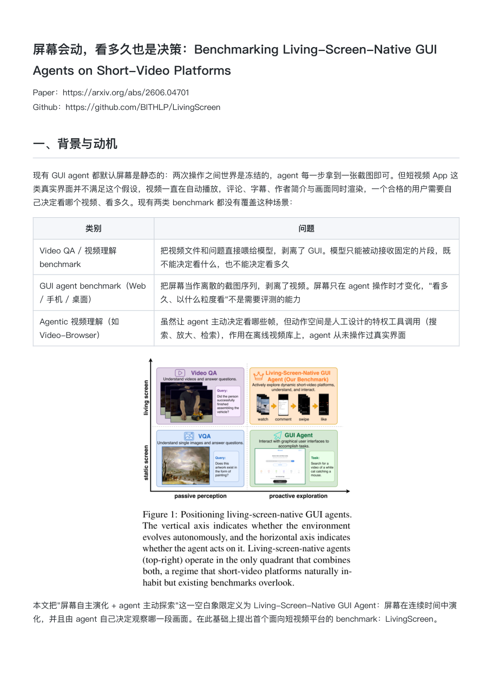
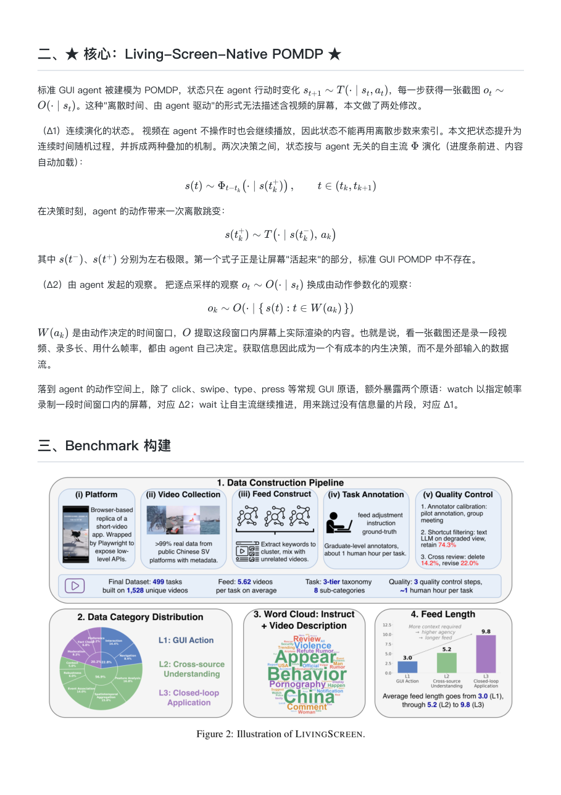
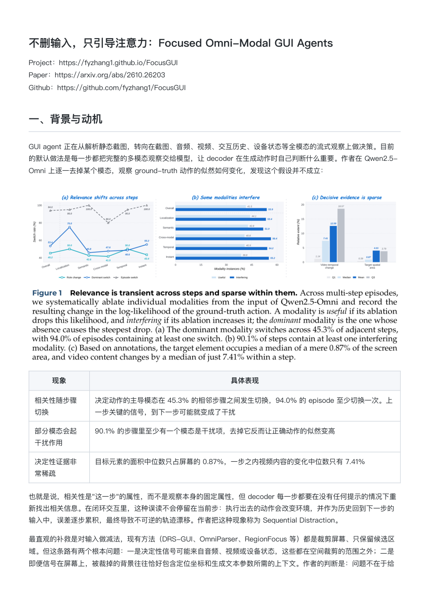
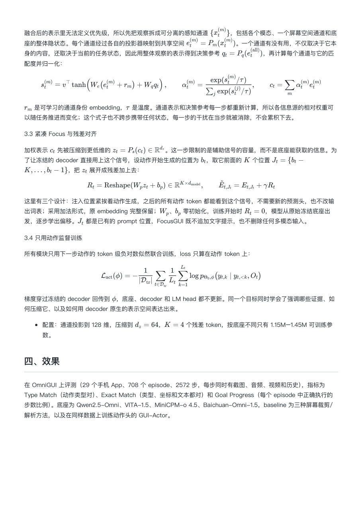

# paper-share-notes

一个 Comate / Claude Code skill：给一篇论文（arXiv 链接或本地 PDF），自动写出一篇中文技术分享 markdown，并配上从论文 PDF 中裁剪出的原图。

文档结构固定为"背景与动机 → 方法总览 → ★ 核心 ★ → 效果"，写作风格来自多轮人工反馈：表格里写完整句子、少用列表、不写要点总结、篇幅控制在 70–90 行。

## 效果展示

下面是用本 skill 生成的三篇文档渲染成 PDF 后的截图（`scripts/paper_pdf.py render` 生成）。

Skill Training with Corruption and Reconstruction Loop（方法类）：开头、背景对比表与方法总览

<p>


</p>

LivingScreen（benchmark 类）：问题定位与核心的任务形式化公式

<p>


</p>

FocusGUI（带公式的方法类）：实证动机与核心模块公式

<p>


</p>

## 目录结构

```
paper-share-notes/
├── SKILL.md                 流程与写作规范（skill 入口）
├── references/examples.md   三篇成稿的代表性片段，作为语气和格式参照
├── scripts/paper_pdf.py     PDF 工具：抽取全文与链接、定位图表、裁图、把 md 渲染成 PDF
└── assets/showcase/         上面的效果截图
```

## 安装

把整个目录放到 skill 目录下即可：

* 个人：`~/.comate/skills/paper-share-notes/`（Claude Code 为 `~/.claude/skills/`）
* 项目：`<项目根目录>/.comate/skills/paper-share-notes/`

依赖：Python 3 与 PyMuPDF（`pip install pymupdf`）。`render` 子命令额外需要 `markdown` 包和本机 Google Chrome，公式通过 CDN 上的 KaTeX 渲染。

## 用法

直接对 agent 说，例如：

* "帮我把 https://arxiv.org/pdf/2606.04701 写成技术分享，放在 ~/notes"
* "参考之前的格式，给 ~/Downloads/paper.pdf 写一份分享文档"

脚本也可以单独使用：

```bash
python scripts/paper_pdf.py extract paper.pdf paper.txt          # 全文 + 文中链接
python scripts/paper_pdf.py locate paper.pdf                     # 每页 Figure/Table 标题与大图坐标
python scripts/paper_pdf.py crop paper.pdf 3 104 70 508 321 fig.png
python scripts/paper_pdf.py render note.md note.pdf --png-dir preview --pages 2
```
